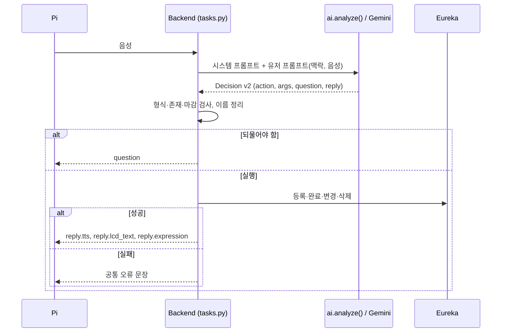

# Decision v2 — AI가 판단과 응답 문장까지 정해진 JSON으로 보낸다

> **상태: 초안.** 이서현과 합의하면 `contracts.md` § 3과 `analyze-interface.md`에 반영하고 코드를 바꾼다.

## 1. 한 줄 목표

AI가 정해진 규칙 안에서 **무엇을 할지와 사용자에게 할 말까지** 담은 JSON을 보내고, Backend는 그 JSON을 **검사하고 Eureka에 실행만** 한다.

### 왜 바꾸나 (11/12 멘토 미팅)

- 지금은 AI가 `action`·`args`만 보내고, Backend `tasks.py`가 action별 분기·이름 검사·응답 문장·조사 처리까지 직접 만든다.
- 사용자의 말은 경우의 수가 너무 많아 Backend 하드코딩으로는 범주가 좁고 복잡해진다 ("돌려막기").
- 그래서 **분류와 판단은 AI에게 위임**하고, AI에게는 명확하고 간단한 업무 지시와 출력 양식만 준다.

### 바뀌는 것 한눈에

| 구분 | 지금 (v1) | v2 |
| --- | --- | --- |
| 판단 (어떤 action, 어떤 업무) | AI | AI (같음) |
| 사용자에게 할 말 (`tts`, LCD) | Backend 템플릿 (action마다 하드코딩) | **AI가 `reply`로 작성** |
| 삭제 확인 질문 문장 | Backend | **AI가 `reply`로 작성** |
| 형식·존재 확인, 삭제 실행 여부 판정 | Backend | Backend (같음) |
| 이름 끝 "업무"·"할 일" 빼기 | AI 프롬프트 규칙 | **Backend 코드** |
| 프롬프트 | 규칙 목록 위주 | 시스템(역할·업무 지시) / 유저(맥락·요청) 분리 |

## 2. 조건과 원칙

1. **LLM 호출은 요청당 1회**를 유지한다. 응답 문장을 위해 두 번 부르지 않는다 (지연이 가장 큰 문제다).
2. **기존 항목(`transcript`, `action`, `args`, `question`)은 그대로 둔다.** `reply`만 추가해 Backend 수정을 줄인다 (이번 주 제출 일정).
3. **`reply`는 "실행에 성공하면 할 말"이다.** AI는 Eureka 실행 전에 문장을 쓰므로, 실행이 실패하면 Backend가 `reply`를 버리고 공통 오류 문장을 쓴다.
4. **되돌릴 수 없는 동작과 데이터 정합성은 Backend가 지킨다.** AI 판단을 믿되 아래 § 6 금지 사항은 코드로 막는다.
5. **간단하고 결정적인 처리는 코드로 한다.** 프롬프트에 세세한 형식 규칙을 늘리지 않는다.

## 3. 출력 양식

```json
{
  "transcript": "보고서 검토 금요일로 미뤄줘",
  "action": "update_due",
  "args": { "item_id": "t1", "due_at": "2026-11-21T18:00:00+09:00" },
  "question": null,
  "reply": {
    "tts": "보고서 검토 마감을 금요일 오후 6시로 바꿨어요.",
    "lcd_text": "마감 변경 완료",
    "expression": "happy"
  }
}
```

| 항목 | 뜻 | v1 대비 |
| --- | --- | --- |
| `transcript` | 이번에 사용자가 한 말 (받아쓰기) | 같음 |
| `action` | `create_task` · `list_tasks` · `complete_task` · `update_due` · `delete_task` · `set_reminder` · `clarify` | 같음 |
| `args` | `name`, `due_at`, `offset_minutes`, `item_id`, `range`, `candidates` 중 그 action이 쓰는 것 | 같음 |
| `question` | 되물을 문장. `clarify`일 때만 | 같음 |
| `reply.tts` | 실행에 성공하면 Pi가 읽을 문장 (짧은 한국어 한두 문장) | **추가** |
| `reply.lcd_text` | LCD 문구 (12자 안팎) | **추가** |
| `reply.expression` | `happy` · `speaking` · `thinking` · `surprised` 중 하나 | **추가** |

action별 `reply` 내용:

| `action` | `reply.tts`에 담을 말 |
| --- | --- |
| `create_task` | 등록한 업무와 마감 ("보고서 작성 업무를 내일 오후 3시 마감으로 등록했어요.") |
| `list_tasks` | `open_tasks`에서 범위에 맞는 업무를 마감순으로 최대 5개 읽기. 없으면 "없어요" |
| `complete_task` | 완료한 업무 |
| `update_due` | 업무와 바뀐 마감 |
| `delete_task` | **첫 요청:** 확인 질문 ("보고서 검토 업무를 삭제할까요? 마감은 오늘 오후 6시예요.") / **확인 답:** 삭제했다는 말 |
| `set_reminder` | 업무와 알림 시점 (Backend 미구현 동안은 쓰지 않음) |
| `clarify` | `reply`는 `null`. 기존처럼 `question`을 읽는다 |

## 4. 프롬프트 구조

**시스템 프롬프트** — 매 요청 같음

1. 역할: "너는 데스크펫 업무 비서다."
2. 업무 지시: 사용자 요청을 맥락에 따라 분석해 action을 고르고, 실행에 필요한 값과 사용자에게 할 말을 정한다.
3. 판단 기준 (짧게): 대상·날짜가 모호하면 되묻는다, 날짜를 지어내지 않는다, `item_id`는 목록에 있는 것만 쓴다, 마감을 바꾸는 말은 등록이 아니다, 완료와 삭제를 구분한다.
4. 출력 양식: § 3의 JSON 하나만 출력한다.

**유저 프롬프트** — 요청마다 바뀜

```text
사용자가 아래와 같이 요청했어. 맥락을 보고 요청을 분석해서 정해진 JSON으로 답해줘.

[맥락]
now: 2026-11-17T14:00+09:00 (월요일)
open_tasks: [...]
pending: {...}   ← 재질문 중일 때만

[사용자 요청]
(오디오 또는 텍스트)
```

**프롬프트에서 빼서 코드로 옮길 것**

| 규칙 | 옮길 곳 |
| --- | --- |
| 이름 끝의 "업무", "일", "할 일", "태스크" 빼기 | Backend 이름 정리 함수 |
| 알림 기본값 60분 | Backend (지금도 코드) |
| 날짜만 말하면 23:59 | **결정 필요** (§ 8-2) |

## 5. 시나리오

| # | 상황 | AI 출력 | Backend |
| --- | --- | --- | --- |
| 1 | "내일 3시까지 보고서 작성 추가해줘" | `create_task` + `reply` "등록했어요" | 이름 정리 → 검사 → Eureka 등록 → `reply` 전달 |
| 2 | "오늘 뭐 있지?" | `list_tasks(today)` + `reply` 목록 읽기 | Eureka 호출 없음 → `reply` 전달 |
| 3 | "보고서 삭제해줘" (보고서 2개) | `clarify` + `question` "보고서 검토와 보고서 작성 중 어떤 업무인가요?" | `pending` 저장 → `question` 전달 |
| 4 | "보고서 검토 삭제해줘" | `delete_task(t1)` + `reply` 확인 질문 | `pending`에 삭제 대상 저장 → `reply` 전달 (삭제 안 함) |
| 5 | (4 다음) "응" | `delete_task(t1)` + `reply` "삭제했어요" | 긍정 답인지 **Backend가 판정** → Eureka 삭제 → `reply` 전달 |
| 6 | "보고서 검토 금요일로 미뤄줘" | `update_due(t1, 금요일 18:00)` + `reply` | 미래인지 검사 → Eureka 변경 → `reply` 전달 |
| 7 | 6에서 Eureka 실패 | (같음) | `reply` 버리고 "요청을 처리하지 못했어요" |
| 8 | AI가 목록에 없는 `item_id`를 냄 | `complete_task(t9)` | 실행하지 않고 "어떤 업무를 완료할까요?" 되묻기 |

## 6. 금지 사항 — Backend가 코드로 막는다

1. 목록에 없는 `item_id`로 실행하지 않는다.
2. 과거 마감으로 등록·변경하지 않는다.
3. 삭제는 확인 질문에 긍정 답을 받은 뒤에만 한다. 긍정·부정 판정은 Backend가 한다.
4. Eureka 실행이 실패하면 `reply`(성공 문장)를 쓰지 않는다.
5. `reply`가 비었거나 형식이 틀리면 Backend 기본 문장을 쓴다 (요청 전체를 실패로 만들지 않는다).
6. 업무 이름이 일반어·날짜뿐이거나 사용자가 말하지 않은 이름이면 등록하지 않는다 (기존 이름 검증 유지).

## 7. 시퀀스 다이어그램



## 8. 결정이 필요한 것 — 이서현과 정할 것

1. **음성 전달 방식:** 미팅에서 "음성 자체를 보내기보다 `사용자가 {음성}이라고 요청했어` 형태로"라고 했다. 받아쓰기를 따로 하면 호출이 2번이 되어 느려진다.
   **제안:** 음성은 지금처럼 한 번에 보내고, 유저 프롬프트를 § 4처럼 업무 지시 형태로 바꾼다.
2. **날짜 변환:** "다음 주 수요일 오후 3시" 같은 한국어 날짜를 코드로 바꾸기는 어렵다.
   **제안:** 날짜 계산은 AI가 하고, 코드는 형식과 과거 여부만 검사한다.
3. **`list_tasks` 문장:** AI가 목록을 읽는 문장을 쓰면 Backend 필터(지난 마감 제외, 최대 5개)와 어긋날 수 있다.
   **제안:** AI에게 같은 기준을 주고, 시험해서 어긋나면 이 action만 Backend 템플릿을 유지한다.
4. **`reply` 검사 수준:** 문장 길이, 표정 값 외에 무엇을 검사할지.

## 9. 검증

1. 평가셋 35문항을 v2로 다시 실행한다. **정답 수와 지연(중앙값·최대)을 v1과 비교**해 기록한다. JSON이 길어져 지연이 늘었는지가 핵심이다.
2. 평가셋에 `reply` 확인을 추가한다: `reply`가 있는지, 표정 값이 허용값인지, 업무 이름이 `tts`에 들어 있는지.
3. Backend 테스트: § 6 금지 사항마다 테스트를 하나씩 둔다 (특히 7번 시나리오: 실행 실패 시 `reply`를 쓰지 않음).
4. 음성(`/api/voice`)으로도 몇 문항 확인한다.

## 10. 작업 나누기

| 작업 | 담당 |
| --- | --- |
| `schemas.py`에 `Reply` 추가 (합의 후, 같이 쓰는 파일) | 박시현 → 이서현 리뷰 |
| `ai.py` 프롬프트를 시스템/유저로 재구성, `reply` 작성 지시, 코드로 옮긴 규칙 삭제 | 박시현 |
| 평가셋에 `reply` 검사 추가, v1·v2 비교 기록 | 박시현 |
| `tasks.py`에서 `reply` 사용, 템플릿은 기본 문장으로만 남기기, 이름 정리 함수 | 이서현 |
| `contracts.md` § 3, `analyze-interface.md` 갱신 | 박시현 (합의 후) |
